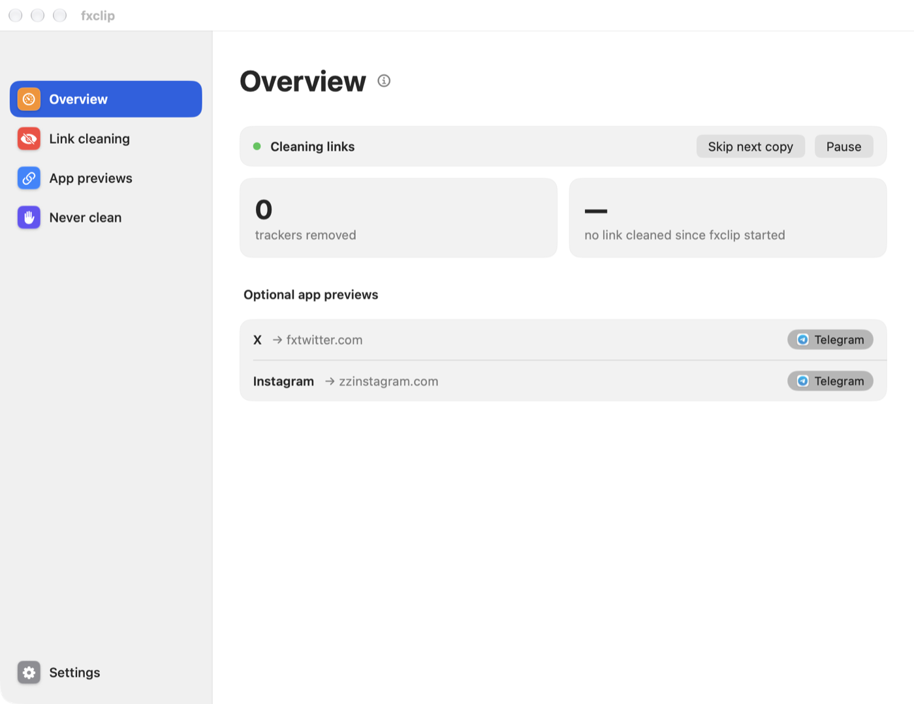
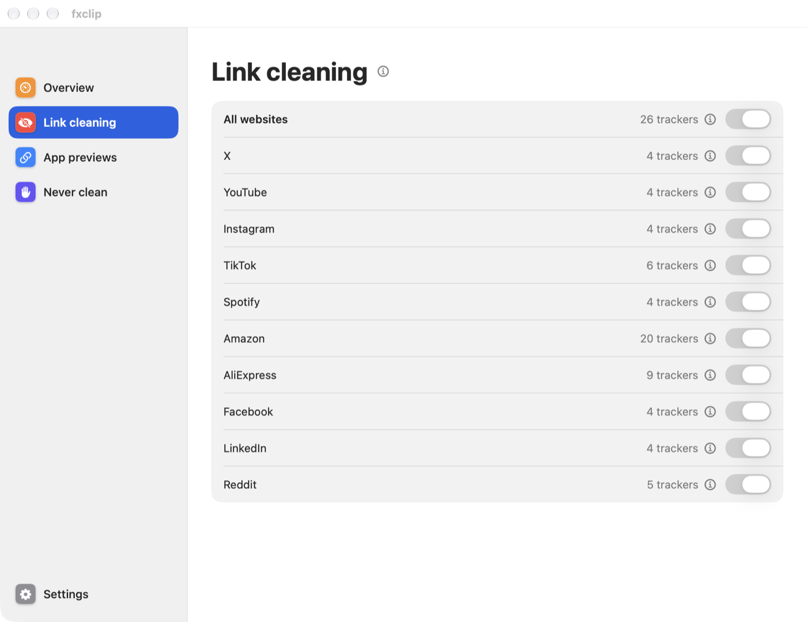
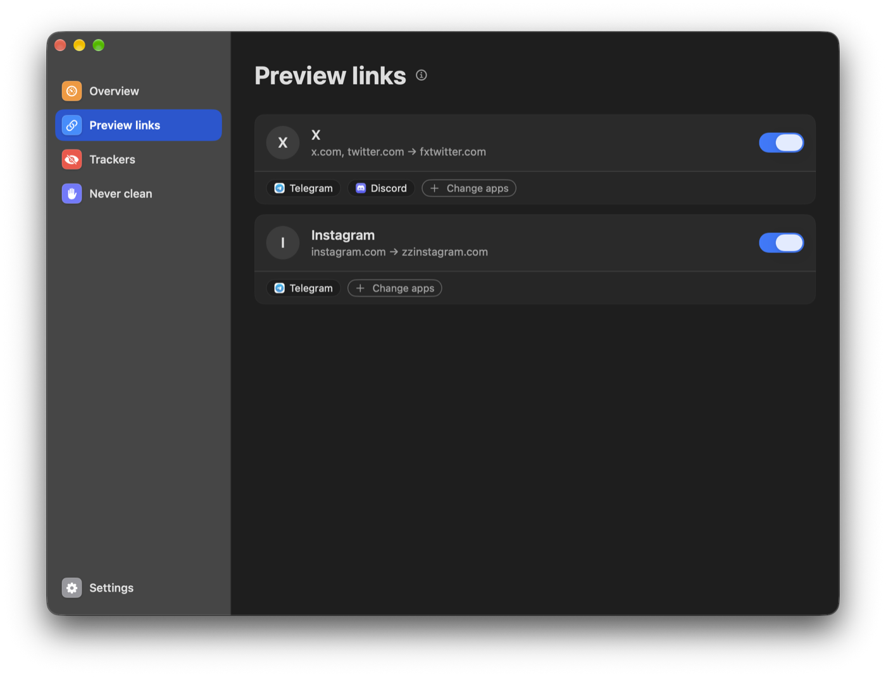

<div align="center">
  
  <h1>fxclip</h1>
  <p>Clean links, ready to share.</p>

  
  
  

  <a href="https://github.com/c0mm0n/fxclip/releases/latest/download/fxclip.dmg"></a>
  <a href="https://github.com/c0mm0n/fxclip/releases/latest/download/fxclip-windows-x64.zip"></a>
  <a href="https://github.com/c0mm0n/fxclip/releases/latest/download/fxclip-linux-x86_64.tar.gz"></a>
  <a href="https://github.com/c0mm0n/fxclip/releases/latest/download/fxclip-android.apk"></a>
</div>

---

fxclip cleans the links you copy, removing tracking parameters (`utm_*`, `fbclid`, YouTube's `si`, Amazon's `ref`…) while keeping useful details like timestamps, searches and product options. It sits in your menu bar or tray, ready whenever you copy a link.

As an optional extra, fxclip can adapt links for better previews in the destination apps you choose. For example, X and Instagram links can use preview-friendly mirrors in Telegram. Other apps get the clean original.



## Features

- 🧹 **Clean every link you copy**: trackers removed on all websites, plus site rules for X, YouTube, Instagram, TikTok, Spotify, Amazon, AliExpress, Facebook, LinkedIn and Reddit
- 🎛️ **You decide what gets trimmed**: switch sites on and off, and keep a list of websites to never touch
- ⏸️ **Pause or skip**: pause cleaning, or leave just the next copy as is
- 🖥️ **Your choice of presence**: menu bar icon, Dock icon, open at login
- 🔗 **Optional app previews**: adapt X and Instagram links for better previews in the destination apps you choose, such as Telegram. Other apps get the clean original
- 🔒 **Private**: link cleaning stays offline, with no account or analytics. On Mac, Windows and Linux, optional update checks contact GitHub; links are never sent
- ⬆️ **Mac updates**: check from the app menu, menu bar or Settings, download an update, then install and relaunch. Automatic checks are off until you enable them; downloads and installation always ask
- 🙈 **Polite with clipboard managers**: the preview rewrites are marked transient, so they don't pile up in your clipboard history

<table>
  <tr>
    <td></td>
    <td></td>
  </tr>
</table>

## Get Started

### macOS (13 Ventura or later)
Grab `fxclip.dmg` from the [latest release](https://github.com/c0mm0n/fxclip/releases/latest), open it and drag fxclip to Applications.

fxclip isn't notarized by Apple yet, so macOS blocks the first launch: open **System Settings › Privacy & Security**, scroll down and click **Open Anyway**. You only do this once.

From version 0.4.0, use **Check for Updates…** in fxclip or **Settings › Updates**. Automatic checks are optional and run once a day when enabled. Downloading and installing always require confirmation. If you have an older version, install the new DMG once to get the updater. Install the app in a writable Applications folder before updating; running it directly from the DMG cannot replace the app.

### Windows (10/11, x64)
Unzip `fxclip-windows-x64.zip` and run `fxclip.exe`; it lives in the tray, with the same settings window as on the Mac. It isn't signed yet, so SmartScreen may warn: click **More info › Run anyway**. Rewritten preview links stay out of Win+V history. Details: [Windows/README.md](Windows/README.md).

### Android (8.0+)
Download `fxclip-android.apk` from the [latest release](https://github.com/c0mm0n/fxclip/releases/latest) and install it. Android forbids watching the clipboard in the background, so cleaning is one tap:
share a link to **Clean link**, pick it in the text selection menu, or use the quick-settings tile
or the home-screen widget. Optional preview links adapt to Telegram. No permission is requested,
not even internet. Details: [android/README.md](android/README.md).

### Linux (Wayland)

Linux 0.6.0 adds **Check for Updates…** in the Qt tray and Settings. Optional daily checks run only while the interface is open; downloading and installing require confirmation. Updates preserve settings and login startup, restart the interface and service, and restore the previous files if installation or relaunch fails. Install the new Linux download manually once to get the updater.
Works on Sway, Hyprland and KDE Plasma (GNOME Wayland doesn't let background apps watch the clipboard). wl-clipboard comes bundled (2.3, with KDE's newer clipboard protocol); on KDE, install `kdotool` for previews. Then:
```shell
tar xzf fxclip-linux-x86_64.tar.gz && cd fxclip-linux-x86_64 && ./install.sh
fxclip check
```
It runs as a systemd user service with an optional Qt 6 desktop window (`fxclip-ui`) for settings, service state and Wayland diagnostics. Settings live in `~/.config/fxclip/settings.json`, shared with the other platforms. Details: [Linux/dist/README.md](Linux/dist/README.md).

### Build from source
Requires Xcode and [XcodeGen](https://github.com/yonaskolb/XcodeGen) (`brew install xcodegen`).

```shell
xcodegen generate
open FxClip.xcodeproj
```

To sign with your own Apple team, put `DEVELOPMENT_TEAM = <your team id>` in a `Local.xcconfig` at the root (it's git-ignored). `tools/make_dmg.sh <version>` builds the same ad-hoc signed DMG as the releases.

Engine tests: `swift test --package-path Engine`.

## How it works

- `Shared/rules.json` holds every rule: tracker parameters, site rules and preview mirrors. No code change is needed to add a site.
- `Engine/` is the cleaning engine (Foundation only), tested against `Shared/vectors.json`, a list of before/after links.
- `App/` is the macOS menu bar app: it watches the clipboard, applies the engine, and swaps the preview link in and out as you change apps.
- `Linux/` is the Wayland daemon and optional Qt desktop UI; the daemon reuses the same Swift engine.
- `android/` is the Android app in Kotlin/Compose, with its own port of the engine held to the same test files.
- `Windows/` is the tray app in C#, with its own port of the engine held to the same test files (`Shared/vectors.json`, `Shared/settings_vectors.json`).

## Releases

Every merge to `main` automatically builds and tests all four platforms, then publishes the downloads together. The tag is created only after all builds pass.

A new `release-notes/vX.Y.Z.md` selects that version (for example `v0.3.0`). Otherwise the patch version increments automatically and GitHub generates the change list. Re-running a published commit does not create another release. Explicit version tags are still supported.

## Requirements

- Android 8.0 or later
- macOS 13 Ventura or later
- Windows 10/11 x64
- Linux with a Wayland compositor that supports data-control (Sway, Hyprland, KDE Plasma) and `wl-clipboard`

Windows 0.5.0 adds a per-user installer and in-app updates in Settings/the tray menu. Automatic checks are optional and off by default; downloading and restarting require confirmation. Cleaning stays local, while authorized updates contact GitHub. Install the complete new Windows download manually once.
